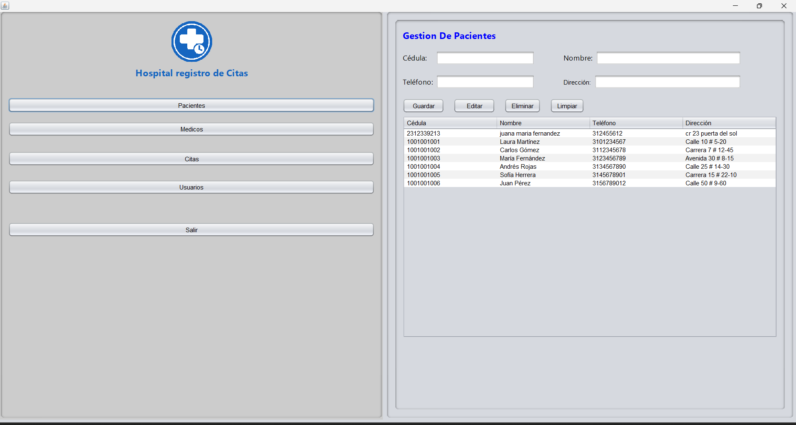
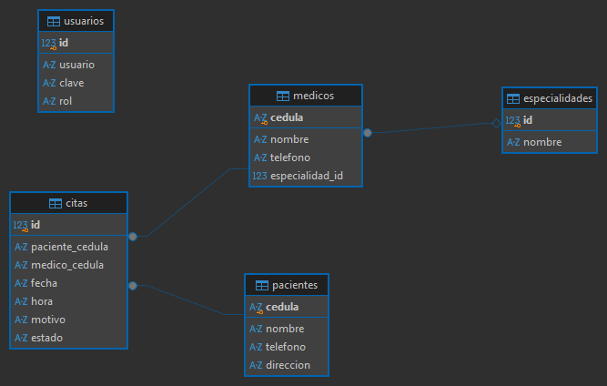

# Sistema de citas para un hospital (HospitalCitas)

**Proyecto del Taller de Panel Administrativo**

Tecnología en Desarrollo de Sistemas Informáticos

🗓️ II Semestre 2026

👨‍🏫 Profesor: Mag. Carlos Adolfo Beltrán Castro

👨‍🎓 Estudiantes:

- Deivinson Elias Garcia Paez - C.C. 1005326925
  
- Yeison Fabian Hernández Martinez - C.C. 1005333487



Pantalla inicial con el menú del proyecto

## 📝 Descripción del Proyecto

Programa de escritorio para manejar las citas de un hospital, hecho en **Java SE - Swing** con NetBeans. Desde una sola ventana se registran los pacientes, los médicos con su especialidad, las citas y los usuarios del sistema.

Los datos se guardan en SQLite, así que la base de datos queda en un solo archivo (`hospital.db`) dentro del proyecto y no hay que instalar ningún servidor.

Quedaron funcionando los CRUD de **Pacientes**, **Médicos**, **Citas** y **Usuarios** (guardar, ver en la tabla, editar y eliminar), todos conectados a la base de datos.

## 📁 Estructura del Proyecto

- **Menú de opciones** al lado izquierdo, con el logo y el nombre "Hospital registro de Citas" arriba:
  - Pacientes
  - Médicos
  - Citas
  - Usuarios
  - Salir
- **Vistas - CRUD** con campos, botones (Guardar, Editar, Eliminar, Limpiar) y tabla de registros. El panel derecho cambia con un CardLayout.
  - **Pacientes:** cédula, nombre, teléfono y dirección.
  - **Médicos:** cédula, nombre, teléfono y especialidad (6 especialidades vienen cargadas por defecto).
  - **Citas:** paciente, médico, fecha, hora, motivo y estado (Pendiente, Atendida o Cancelada). No deja poner una fecha anterior a hoy ni darle a un médico dos citas a la misma fecha y hora.
  - **Usuarios:** usuario, clave y rol. Trae un administrador por defecto (`admin` / `admin123`) que no se puede eliminar.
- **Salir** muestra el mensaje "Sesión cerrada. ¡Hasta pronto!" y cierra el programa.

Paquetes del código:

```
src/
├── hospitalcitas/   HospitalCitas (main)
├── modelo/          Paciente, Medico, Especialidad, Cita, Usuario
├── dao/             Conexion, PacienteDAO, MedicoDAO, EspecialidadDAO, CitaDAO, UsuarioDAO
└── vista/           VentanaPrincipal, PanelPacientes, PanelMedicos, PanelCitas, PanelUsuarios
```

## 🗄️ Base de Datos

Cinco tablas: `pacientes`, `especialidades`, `medicos`, `citas` y `usuarios`. Cada médico tiene una especialidad y la tabla `citas` une al paciente con el médico. El script está en [`script/hospital_script.sql`](script/hospital_script.sql), aunque la clase `Conexion` crea las tablas sola la primera vez que se abre el programa.



## 💻 Lista de Tecnologías Usadas

- Java SE (JDK 17 o superior)
- Swing
- NetBeans IDE
- SQLite
- Driver sqlite-jdbc 3.51.0.0
- DBeaver (para revisar la base de datos y sacar el diagrama)

## 🔧 Instalación y ejecución

1. Descargar el proyecto (botón **Code > Download ZIP**), descomprimirlo y abrirlo en NetBeans con **File > Open Project**.
2. El driver `sqlite-jdbc-3.51.0.0.jar` ya viene en la carpeta `lib`. Si NetBeans marca la librería en rojo, clic derecho en **Libraries > Add JAR/Folder** y escoger ese archivo.
3. Ejecutar con **Run (F6)**. La ventana abre maximizada. Si no existe `hospital.db`, se crea solo y en la consola sale "Base de datos lista".
